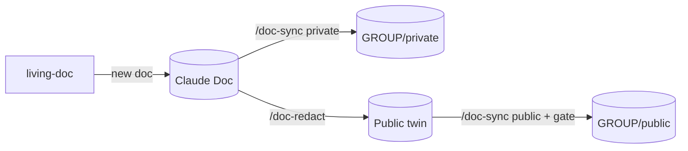

# claudedocs

Two things live here:

1. **The `living-docs` Claude plugin**: three skills that start, redact and mirror living Claude Docs.
2. **Published copies of selected Claude Docs** under `docs/`, built into PDF, Word and HTML.

## The skills

| Skill | Start it with | What it does |
| --- | --- | --- |
| `living-doc` | `/living-doc`, or "start a living doc for X" | Builds a new Claude Doc from the template: topic tabs plus Claude context, Documentation, Task checklist and Changelog |
| `doc-redact` | `/doc-redact`, or "make a public version of this doc" | Makes and updates the doc's redacted **public twin**, with later changes carried over as suggestions |
| `doc-sync` | `/doc-sync private\|public`, or "sync this doc" | Commits the changed tabs to GitLab, one signed commit per doc. Public syncs come only from the reviewed twin |



### What they need

| Need | Used by |
| --- | --- |
| Claude Docs tools and the asset tools (`read_asset`, `delete_asset`) | All three |
| GitLab's MCP server (`https://gitlab.com/api/v4/mcp`) as a custom connector | doc-sync, doc-redact (and living-doc's first mirror) |
| A shell (optional) | doc-sync, doc-redact run `scripts/public_gate.py`; without a shell they apply the same rules by hand |

Each skill checks for its tools first and stops, naming what's missing, rather than half-running. They load in Claude Code but only run where the Claude Docs tools exist (Claude on the web, desktop or mobile).

The full setup, covering the GitLab group, the bot account, the connector and the pipeline, is in the build guide: `docs/living-docs-guide/`.

### Set your names

Each `SKILL.md` starts with a **Setup values** table (GROUP, BRANCH, OWNER, BOT, AUTHOR, LANG, ENGLISH). Set them all at once:

```sh
python3 tools/skills.py configure GROUP=my-docs OWNER="Your Name" AUTHOR="Your Name" LANG=en-AU "ENGLISH=Australian English (en-AU)"
python3 tools/skills.py validate
```

`validate` fails if the skills disagree on a value.

### Install

**Claude (web, desktop, mobile):** run `python3 tools/skills.py package`, then upload each `dist/<skill>.zip` in **Customize → Skills**. CI builds the same zips as job artifacts.

**Claude Code:**

```text
/plugin marketplace add <path to this repo, or owner/repo once it's on GitHub>
/plugin install living-docs@claudedocs
```

## Layout

```text
.claude-plugin/marketplace.json     marketplace entry for the plugin
plugins/living-docs/
  .claude-plugin/plugin.json        plugin manifest (version lives here and in marketplace.json)
  skills/<skill>/SKILL.md           instructions Claude loads when the skill triggers
  skills/<skill>/references/*.md    detail loaded only when a step needs it
  skills/<skill>/scripts/           copies of shared scripts (don't edit)
shared/                             canonical public gate (public_gate.py + public-gate.md)
tools/skills.py                     sync, validate, package, configure
docs/<slug>/                        mirrored Claude Docs (overwritten by /doc-sync)
templates/, build.py                PDF, Word and HTML build
```

## Source of truth

- **Skills:** `plugins/living-docs/skills/` in this repo, versioned with git. The Skills tab of the build guide and the Living Doc Template doc still hold the older one-file versions. Point those tabs here rather than copying the text again, so the two can't drift.
- **The public gate:** `shared/`. Edit it there, then run `python3 tools/skills.py sync`. `validate` fails if a copy has drifted.
- **Docs:** the Claude Doc is the source of truth. Don't edit `docs/` here: the next sync overwrites it.

## Docs build

- `docs/<slug>/doc.yml` lists each doc's tabs. Only tabs with `publish: true` are built.
- Each push to main builds PDF, Word and HTML (job artifacts; Pages from main).
- Tag `vX.Y` to cut a release with the files attached.

## Versioning

Bump `version` in both `plugin.json` and `marketplace.json` when a skill changes, and add a line to `CHANGELOG.md`. `validate` checks that the two versions match.

## License

None yet. Add one before others install or reuse this.
